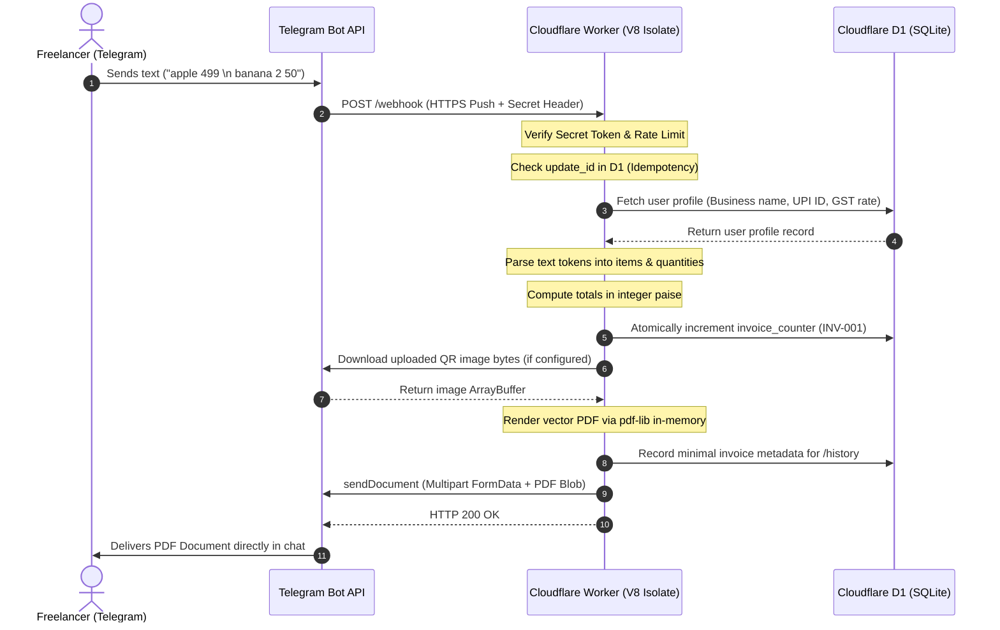
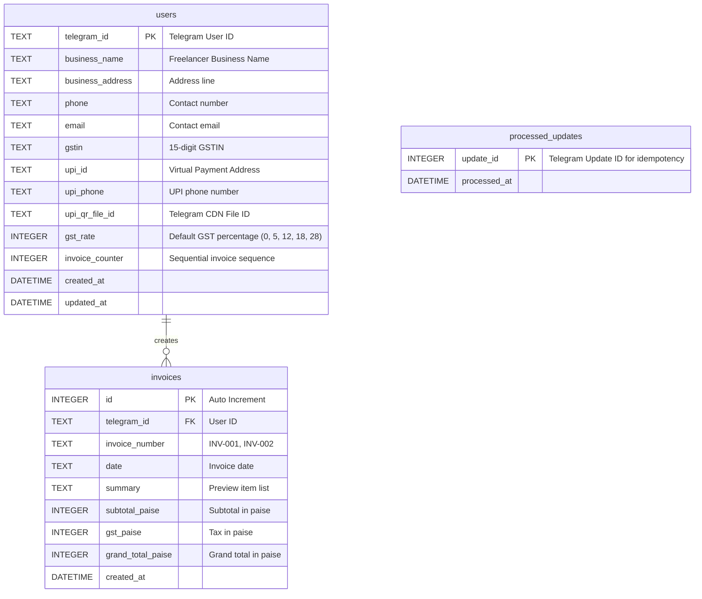

# BillKaro – Telegram Invoice Generator Bot

> A fast, production-ready Telegram bot that enables freelancers to generate professional, minimalist PDF invoices with UPI payment QR codes directly inside Telegram chat—built with **zero infrastructure cost (₹0/month)**.

---

## 📑 Table of Contents

- [Overview](#overview)
- [Core Features](#core-features)
- [System Architecture & Design](#system-architecture--design)
- [Text Parsing Logic](#text-parsing-logic)
- [Database Design](#database-design)
- [Project Directory Structure](#project-directory-structure)
- [Getting Started Locally](#getting-started-locally)
- [Running Automated Tests](#running-automated-tests)
- [Production Deployment Guide](#production-deployment-guide)
- [Zero-Cost Infrastructure Analysis](#zero-cost-infrastructure-analysis)
- [Security & Compliance](#security--compliance)

---

## 🚀 Overview

Freelancers and micro-business owners often waste time filling out multi-step invoice forms or using heavy web software just to bill a client. **BillKaro** removes all friction:

1. Open Telegram and message the bot.
2. Type items and prices in plain text (e.g., `web design 15000` or `banana 2 50`).
3. The bot automatically understands items, quantities, and prices.
4. It calculates subtotal, optional GST, and grand total using safe integer paise arithmetic.
5. It compiles a vector PDF invoice embedding the freelancer's business details and UPI QR code.
6. The PDF is delivered directly back into the Telegram chat in seconds.

---

## ✨ Core Features

* **Instant Text-to-Invoice Parser:** No forms or buttons required to add items.
* **Pixel-Perfect Vector PDF:** Minimalist A4 invoice generated entirely in-memory using `pdf-lib` (clean typography, itemized tables, highlighted totals, and payment section).
* **UPI Payment & QR Image Upload:** Freelancers can upload a photo of their PhonePe/GPay/Paytm merchant QR code; the bot extracts and embeds the image directly into generated invoices.
* **Safe Paise Arithmetic:** Financial arithmetic is computed in integer paise ($1\text{ INR} = 100\text{ paise}$) to avoid IEEE 754 floating-point rounding errors.
* **GST Compliance:** Optional GST rates (0%, 5%, 12%, 18%, 28%) with automatic 50/50 CGST & SGST or IGST tax row breakdowns, plus 15-character GSTIN structural validation.
* **Persistent Mobile Reply Keyboard:** Intuitive 1-tap buttons right above the mobile keyboard for `/invoice`, `/history`, `/profile`, `/payment`, `/tax`, and `/help`.
* **Zero Customer Data Retention:** Only freelancer business metadata is kept. Zero customer information or invoice PDFs are retained in the database.
* **Idempotent Webhooks:** Protects against duplicate Telegram webhook deliveries using Telegram's unique `update_id`.
* **Sliding Window Rate Limiter:** Built-in protection against burst requests and spam.

---

## 🏛️ System Architecture & Design

BillKaro is architected as an **event-driven, serverless push system** deployed on Cloudflare's global edge network.

### High-Level Flowchart



### Serverless vs. Traditional VPS

| Dimension | Traditional Server (VPS / Long Polling) | BillKaro (Cloudflare Workers Serverless) |
|---|---|---|
| **Idle Cost** | Server runs 24/7 consuming CPU & memory | **Scales to zero** (0 compute used when idle) |
| **Cold Start** | Seconds or minutes | **< 5 milliseconds** (V8 isolate) |
| **Maintenance** | SSH keys, OS updates, firewall, PM2/Docker | **Zero maintenance** (managed edge runtime) |
| **SSL / HTTPS** | Manual Certbot / Nginx configuration | **Managed SSL certificate** included on `*.workers.dev` |
| **Concurrency** | Limited by single VM memory/threads | **Spins up hundreds of parallel instances** on demand |

---

## 🔍 Text Parsing Logic

The text parser ([src/parser.js](file:///c:/Users/apsha/BillDostApp/src/parser.js)) accepts arbitrary multi-line text and extracts descriptions, quantities, and unit prices:

### Rules:
1. **Single Trailing Number:** The number is treated as unit price; quantity defaults to `1`.
   * `apple 499` $\to$ Qty: `1`, Price: `₹499.00`
   * `orange juice 120` $\to$ Qty: `1`, Price: `₹120.00`
2. **Two Trailing Numbers:** The first is quantity; the second is unit price.
   * `banana 2 50` $\to$ Qty: `2`, Price: `₹50.00`
   * `web design 1 5000` $\to$ Qty: `1`, Price: `₹5000.00`
3. **Item Description:** Everything before the numbers is preserved as the description. First character is auto-capitalized.
4. **Validations:** Blank lines are ignored. Quantities and prices $\le 0$ or non-numeric tokens trigger clean line-numbered error messages.

---

## 🗄️ Database Design

Cloudflare D1 (serverless SQLite) is used with foreign keys and indexes.



---

## 📁 Project Directory Structure

```text
BillDostApp/
├── src/
│   ├── index.js          # Main Cloudflare Worker fetch handler & webhook router
│   ├── telegram.js       # Telegram Bot API client (sendMessage, sendDocument, getFile)
│   ├── parser.js         # Free-form multi-line text invoice parser
│   ├── calculator.js     # Safe integer paise math, GST splitting & INR currency formatter
│   ├── pdf.js            # Minimalist vector PDF generator built with pdf-lib
│   ├── db.js             # D1 prepared statements, upserts, counters, and queries
│   ├── profile.js        # Business profile, UPI, and tax settings controller
│   ├── history.js        # Invoice history view (/history)
│   ├── security.js       # Sliding window rate limiter (30 actions/min)
│   └── keyboards.js      # Persistent Telegram reply keyboard layout
├── schema.sql            # SQLite schema migration script for D1
├── wrangler.jsonc        # Cloudflare Workers & D1 database bindings
├── package.json          # Project dependencies, type=module, and scripts
├── test-webhook.js       # Comprehensive local verification test suite
├── .dev.vars.example     # Local environment variables template
└── README.md             # Project documentation and system design
```

---

## 🛠️ Getting Started Locally

### Prerequisites
* **Node.js** v20.x or higher installed.
* A Telegram Bot Token from **[@BotFather](https://t.me/botfather)**.

### 1. Clone & Install
```bash
git clone <repository-url>
cd BillDostApp
npm install
```

### 2. Configure Local Secrets
Create a `.dev.vars` file in the root directory (already included in `.gitignore`):
```ini
TELEGRAM_BOT_TOKEN="YOUR_BOTFATHER_TOKEN"
TELEGRAM_SECRET_TOKEN="your_custom_secret_password_123"
```

### 3. Run the Automated Test Suite
Verify parser, calculations, D1 queries, rate limiting, and PDF generation:
```bash
npm test
```
*(This will generate a `sample_invoice.pdf` in your project root for instant visual inspection).*

### 4. Start Local Development Server
```bash
npm run dev
```
Wrangler will boot a local worker at `http://127.0.0.1:8787`.

---

## 🚢 Production Deployment Guide

Deploying BillKaro takes less than 3 minutes using Cloudflare's free tier:

### Step 1: Log in to Cloudflare CLI
```bash
npx wrangler login
```

### Step 2: Create Remote D1 Database
```bash
npx wrangler d1 create billkaro-db
```
Copy the generated `database_id` UUID and paste it into line 13 of [wrangler.jsonc](file:///c:/Users/apsha/BillDostApp/wrangler.jsonc):
```jsonc
"d1_databases": [
  {
    "binding": "DB",
    "database_name": "billkaro-db",
    "database_id": "YOUR_DATABASE_UUID_HERE"
  }
]
```

### Step 3: Run Database Schema Migration
```bash
npm run db:migrate
```

### Step 4: Add Production Secrets to Cloudflare
```bash
npx wrangler secret put TELEGRAM_BOT_TOKEN
# Paste your BotFather API Token

npx wrangler secret put TELEGRAM_SECRET_TOKEN
# Paste your secret token
```

### Step 5: Deploy Worker
```bash
npm run deploy
```
Copy your live HTTPS URL from the output (e.g. `https://billkaro-bot.<subdomain>.workers.dev`).

### Step 6: Activate Telegram Webhook
Open this URL in your web browser:
```text
https://api.telegram.org/bot<TELEGRAM_BOT_TOKEN>/setWebhook?url=<YOUR_WORKER_URL>/webhook&secret_token=<TELEGRAM_SECRET_TOKEN>
```
When you see `{"ok": true, "result": true, "description": "Webhook was set"}`, your bot is live!

---

## 💰 Zero-Cost Infrastructure Analysis

BillKaro is architected to operate comfortably within free tiers without credit card billing surprises:

| Resource | Cloudflare Free Limit | BillKaro Usage (100 Active Freelancers) | Cost |
|---|---|---|---|
| **Worker Invocations** | 100,000 requests/day | ~1,000–3,000 requests/day | **₹0.00** |
| **Worker CPU Time** | Up to 10–50ms / request | Average ~8ms per request | **₹0.00** |
| **D1 Database Storage** | 5 GB storage | < 5 MB / year | **₹0.00** |
| **D1 Reads / Writes** | 5,000,000 reads, 100,000 writes/day | < 10,000 operations/day | **₹0.00** |
| **QR Image Storage** | Unlimited (Stored via Telegram CDN) | 0 bytes database storage | **₹0.00** |
| **SSL Certificate** | Included on `*.workers.dev` | Automated zero-touch renewal | **₹0.00** |
| **Total Cost** | — | — | **₹0/month** |

---

## 🔒 Security & Compliance

* **Webhook Secret Verification:** Every request checks the `X-Telegram-Bot-Api-Secret-Token` header. Direct HTTP attempts without this secret are dropped with `401 Unauthorized`.
* **SQL Injection Prevention:** All D1 operations use prepared statements with parameterized `.bind(...)` inputs.
* **Per-User Isolation:** All database reads and writes enforce `WHERE telegram_id = ?` based on Telegram's cryptographically authenticated update envelope.
* **Duplicate Protection:** Tracks `update_id` to guarantee idempotent invoice generation even if Telegram retries delivery.
* **Privacy by Design:** Invoices are generated on-the-fly; customer names, client phone numbers, and raw PDF files are **never** stored.

---

## 📜 Telegram Bot Commands Reference

| Command | Action |
|---|---|
| `/start` | Welcome greeting and activates the persistent Main Menu keyboard |
| `/invoice` | Displays instructions on how to type line items |
| `/profile` | View and edit business profile (Name, Address, Phone, Email, GSTIN) |
| `/payment` | Configure UPI ID and view uploaded QR code status |
| `/tax` | Adjust default GST rate (0%, 5%, 12%, 18%, 28%) |
| `/history` | Displays your 5 most recently generated invoices |
| `/help` | Complete syntax and usage instructions |
| `/set_name <name>` | Update freelancer business name |
| `/set_upi <upi_id>` | Update freelancer UPI ID (e.g. `user@bank`) |
| `/set_gst <rate>` | Set default tax percentage (0, 5, 12, 18, 28) |
| `/set_gstin <gstin>` | Update 15-character GSTIN |
| `[Photo Upload]` | Send any photo of a QR code to automatically save it for invoices |

---

## 📄 License

MIT License. Designed and built for freelancers and developers learning modern serverless backend development.

## Paid access deployment

This project is deployed as a Cloudflare Worker with a D1 database binding (`wrangler deploy`), not as a Cloudflare Pages site. Customer access is restricted to private chats and tied to the sender's numeric Telegram user ID.

Run the idempotent schema against the existing production database to add subscription, payment-review, and shared rate-limit tables:

```bash
npm run db:migrate
```

Configure the following Worker secrets (use your actual values):

```bash
npx wrangler secret put TELEGRAM_BOT_TOKEN
npx wrangler secret put TELEGRAM_SECRET_TOKEN
npx wrangler secret put ADMIN_TELEGRAM_IDS
npx wrangler secret put SUBSCRIPTION_PRICE_MONTHLY_INR
npx wrangler secret put SUBSCRIPTION_PRICE_YEARLY_INR
npx wrangler secret put SUBSCRIPTION_UPI_ID
# Optional payment QR image, previously uploaded to this bot:
npx wrangler secret put SUBSCRIPTION_QR_FILE_ID
```

Keep `TELEGRAM_SECRET_TOKEN` mandatory when setting Telegram's webhook, and pass the matching value as Telegram's `secret_token` parameter.

`ADMIN_TELEGRAM_IDS` accepts comma-separated numeric Telegram user IDs; run `/myid` in a private chat to display the ID. Admins use `/admin` to open the inline admin panel for stats, user listing/search (`/search <telegram_user_id>`), blocking/unblocking, extending access by 30 days, granting 365 days, and payment history. Choose Custom days in a user panel to get the `/admin_days <telegram_user_id> <0-365>` format; 0 removes access. Send `/broadcast your announcement` to message unblocked users. Run `npm run db:migrate:admin-panel` once against an existing production database before deploying the panel; fresh databases include the new column in `schema.sql`. The optional QR value is a Telegram `file_id` belonging to this bot.

Subscription activation is managed by admins; customer `/subscribe` no longer starts self-service payments. Expired customers can still use `/start`, `/help`, and `/status`; profile fields can be cleared with commands such as `/clear_phone` or `/clear_upiphone`. Invoice generation, profile settings, history, and QR uploads require active access. Only set the Telegram webhook after configuring `TELEGRAM_SECRET_TOKEN`; the Worker rejects webhook calls when it is missing or incorrect.

When locally running the Worker, copy `.dev.vars.example` to `.dev.vars` and fill in the same values. Apply `npm run db:migrate` when the D1 database has only the original BillDost schema (or is fresh). If you already applied the previous paid-access schema, run `npm run db:migrate:payment-plans` once to add the plan columns before deploying this version.


